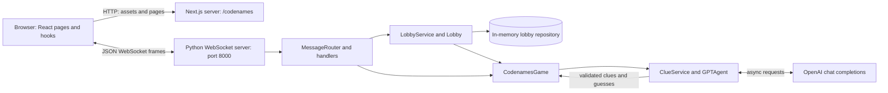

# Codenames-GPT architecture and review

Reviewed: 2026-10-20. This describes the current implementation, not a proposed redesign.

## Scope and summary

The project is a multiplayer Codenames application with human and OpenAI-controlled players. A Next.js browser application communicates directly with a Python WebSocket server. The server owns lobby membership, hidden board information, rules, and AI scheduling. There is no database, account system, REST API, or durable session store.

The review covers all tracked application source, tests, configuration, dependency manifests/lockfile, Dockerfiles, launcher, documentation, and word data. Installed dependencies, Git internals, generated files, and ignored local credentials are not application source and were not audited. Findings below distinguish observed behavior from deployment risks and intentional limitations; historical fixed bugs in `TODO.md` are not reported as current defects.

## System structure



Next.js does not proxy game messages or hold authoritative game state. The browser needs network access to the configured WebSocket endpoint separately from its HTTP connection to Next.js.

### Repository map

| Location | Responsibility |
| --- | --- |
| `dev.py` | Dependency setup/cache, credential prompt, local process supervision, port readiness, browser launch, shutdown |
| `backend/run.py` | Python entry point and logging setup |
| `backend/codenames/websocket_server.py` | WebSocket transport, connection adapters, per-socket context, JSON decoding, cleanup, composition root |
| `backend/codenames/message_router/` | Command registry and pre-lobby, lobby, and game handlers |
| `backend/codenames/services/connection_service.py` | Abstract transport interface and active connection registry |
| `backend/codenames/services/lobby_service.py` | Repository interface/in-memory implementation, membership, capacity, room cleanup |
| `backend/codenames/lobby.py` | Human waiting-room roster, role assignments, readiness, game startup |
| `backend/codenames/model.py` | Roles, users, connection base class, tiles, JSON projections |
| `backend/codenames/game/factory.py` | Fill unoccupied roles with AI and construct the game roster |
| `backend/codenames/game/game.py` | Board generation, turn state, rules, snapshots, win detection, AI task lifetime |
| `backend/codenames/services/clue_service.py` | Apply AI results, guard asynchronous work, handle failures, close AI client |
| `backend/codenames/gpt/` | Role-specific AI inputs, prompts, OpenAI calls, response parsing, no-op AI connection |
| `backend/codenames/options.py` | Import-time environment/file configuration |
| `backend/codenames/util.py`, `backend/wordlist.txt` | Word lookup and 400-word board vocabulary |
| `codenames-gpt-ui/app/` | App Router routes, transport/identity providers, UI components, page logic hooks |
| `codenames-gpt-ui/next.config.js` | `/codenames` base path |
| `codenames-gpt-ui/*config*`, `package*.json` | TypeScript, lint, CSS, test, dependency/build configuration |
| `tests/`, `backend/tests/`, `codenames-gpt-ui/tests/` | Launcher, server/domain, and frontend regression suites |
| Both `Dockerfile`s | Independently runnable backend/frontend images |
| `README.md`, `docs/` | User setup/play instructions, architecture review, TODO, and implementation plans |

## Backend boundaries and ownership

### Transport and command handling

`create_server()` constructs one `InMemoryLobbyRepository`, `LobbyService`, and `ConnectionManager` per server process. Each accepted socket gets a new `WebSocketConnection`, UUID, `User`, and `UserContext`. The adapter bridges `Connection.send_message()` to the domain-facing `CodenamesConnection.send()` interface. AI users use `GPTConnection`, whose send operation does nothing.

`WebSocketServer.handle_connection()` reads and awaits commands sequentially **within a socket**. Other sockets and scheduled AI tasks can execute concurrently at `await` boundaries. It accepts text or binary JSON, verifies a top-level object and string discriminator, and routes by `clientMessageType`. Handlers may return a requester-specific response or trigger broadcasts and return nothing. The router converts `ValueError` into `error`/`invalidRequest`, and unexpected handler exceptions into a generic error. `stateError` represents missing membership/game context.

Membership and role checks use the server-owned `User`; client-supplied UUIDs do not authorize actions. Disconnect cleanup removes the user from their room and unregisters the connection.

### State model

| Entity | Owns / represents |
| --- | --- |
| `ConnectionManager` | Live transports indexed by connection ID |
| `UserContext` | Connection-local user and current lobby ID |
| `User` | Mutable name, team, spymaster flag, readiness, membership flags, transport |
| `Lobby` | UUID, name, owner, human members, lobby revision, optional game |
| `CodenamesGame` | Separate human-plus-AI roster, board, clue, remaining guesses, role/turn, winner, revisions, lifecycle flags, AI tasks |
| `Tile` | Word, secret team, revealed flag |

Human `User` objects are shared between lobby and game rosters; the roster lists themselves are separate. AI players belong to the game roster, not the human lobby roster. The repository stores live mutable objects, not serialized records: substituting a durable database would require more than implementing CRUD methods because game objects contain transports, tasks, and AI clients.

Role indices are a wire-level contract: `0` red spymaster, `1` blue spymaster, `2` red operative, `3` blue operative. Python derives them from enum declaration order; TypeScript declares corresponding enums in both lobby and game type files.

`Tile.to_json()` exposes unrevealed teams only to spymasters. Operative snapshots contain `team: "unknown"` until reveal. This filtering happens on the server, not merely in CSS. Both spymasters can see the entire key; operatives cannot, including after completion under the current policy.

### Lobby and game lifecycle

```text
new socket / no lobby
  -> createLobby or joinLobby
waiting room (name + unique role + ready for every human)
  -> game published, AI fills empty roles, started = false
starting (roster delivered; joins/preferences mutations blocked)
  -> started = true; initial state broadcast; initial AI task if needed
active
  -> winning board reveal
finished (read-only result retained)
  -> last human leaves
disposed (tasks cancelled, AI client closed, room deleted)
```

Rooms accept at most four humans, one per role, and reject new members once a game exists. Switching rooms first leaves previous memberships; destination capacity is rechecked after awaited cleanup. Joining the same room is idempotent. All present humans, including unnamed joiners, participate in the readiness gate. A departure can cause an otherwise-ready waiting room to start.

The factory adds AI for each unoccupied role. The board samples 25 words: nine red, eight blue, seven neutral, one assassin. Red always starts with its spymaster. A valid clue has a nonempty string and a strict integer count from one to the remaining unrevealed tile count. The operative gets exactly that many guesses. A correct own-team guess consumes one; an incorrect guess or exhaustion advances to the opposing spymaster. Completing a team's tiles awards that team the win; selecting the assassin awards the opponent the win. This implementation is a simplified ruleset (see findings).

If a human leaves an active game while others remain, an AI user takes over the same role. Replacing the current player increments the turn token to invalidate old work. Finished games do not create replacements. The last human's departure disposes the game and deletes the lobby; there is no rematch command.

### Async AI execution and consistency

`CodenamesGame.schedule_ai_turn()` creates background work rather than awaiting an OpenAI chain in the socket receive loop. `_tasks` tracks owned tasks; `_ai_turns` prevents duplicate live tasks for the same turn. Turn changes cancel obsolete tasks, excluding the currently executing task. Completion/disposal prevents further play, and disposal awaits cancellation and closes the OpenAI client.

`ClueService` checks the captured user/turn before requesting AI and again after awaits. `GPTAgent` supplies a spymaster with own-team words and all words to avoid, but supplies an operative only unrevealed word candidates plus the clue. `ChatGPT` uses asynchronous chat completions and parses comma-separated text; it does not use a structured response schema.

AI clue failure preserves the turn, records `aiError`, and lets a human request `retryAI`. AI guess failure notifies humans and passes the turn. Short, invalid, duplicate, or exhausted AI guess lists cannot keep an operative turn running indefinitely. `GUESS_DELAY` is applied between AI guesses only.

Snapshots carry `lobbyId`, `gameId`, `turnId`, and revision metadata. Current UI game commands include the game/turn IDs; the server checks them when provided. These checks and task guards protect specific stale-work boundaries, but are not a general transaction system or lock. Broadcasts and cleanup can interleave across sockets, and domain objects perform network I/O directly.

## WebSocket protocol

There is no versioned/shared schema. Payloads are ordinary Python dictionaries and mostly TypeScript `any`. Fields below describe the current registry, not a new API.

| Client command | Payload / phase | Result |
| --- | --- | --- |
| `idRequest` | Any connection | `idAssign { uuid }` for this connection |
| `lobbiesRequest` | Any connection | `lobbiesUpdate { lobbies }`; only joinable waiting rooms |
| `createLobby` | Optional `name` (defaults if absent); nonblank if supplied | Leave previous rooms, create room, return `lobbyJoined { lobbyId }` |
| `joinLobby` | `lobbyId`; room must be joinable, except existing member | `lobbyJoined` or `error` |
| `leaveLobby` | Current membership, if any | Cleanup then `lobbyLeft`; repeat is safe |
| `preferencesRequest` | Optional `player { name, role, ready }`; mutations only before startup | Broadcast `playerUpdate` or start game; empty request after startup broadcasts roster |
| `initialiseRequest` | Current room member | Requester-only `playerUpdate`, or `stateUpdate` if game exists |
| `provideClue` | `word`, `number`, optional `gameId`/`turnId`; current active spymaster | Validate and broadcast updated game |
| `guessTile` | `word`, optional `gameId`/`turnId`; current active operative | Reveal and broadcast, or requester snapshot for already-revealed tile |
| `retryAI` | Optional `gameId`/`turnId`; current failed AI turn | Broadcast cleared failure and reschedule AI |

`playerUpdate` contains the human lobby roster, `lobbyId`, and `lobbyRevision`. `stateUpdate` contains the full game roster (including AI), filtered tiles, `onTurnRole`, `guessesRemaining`, optional clue, `new_turn`, winner, game/lobby/turn IDs, revision, `phase` (`starting`, `active`, `finished`), and `aiError`. The UI sends `includeUserInfo` on initialization, but the handler currently returns the roster regardless of that field.

Successful mutations are generally acknowledged through snapshots, not explicit per-command responses. Errors carry a message and sometimes a code. There are no request IDs, formal delivery acknowledgements, or user-facing pass-turn command.

## Frontend architecture

`app/layout.tsx` nests `WebSocketProvider` outside `PlayerProvider`, with a shared header. It uses Tailwind CSS and a Google font through `next/font`. Routes are relative to the configured `/codenames` base path:

| Route | Page logic | Purpose |
| --- | --- | --- |
| `/` | `useLobbySelectLogic` | Request connection identity/list, create or join room |
| `/[lobbyId]/welcome` | `useSetNameLogic` | Confirm display name, then navigate into room |
| `/[lobbyId]/lobby` | `useLobbyLogic` | Read roster, select role/readiness, navigate when game starts |
| `/[lobbyId]/game` | `useGameLogic.tsx` (exported as `useThings`) | Consume game state, enable legal actions, show failure/retry/result |
| `/error` | Page component | Generic context/membership error screen |

### Transport, events, and snapshots

`wsProvider.tsx` creates one socket for the layout lifetime. It queues messages while connecting, flushes on open, and ignores events from obsolete socket instances (important during development Strict Mode). It performs minimal inbound envelope validation.

Two mechanisms serve different purposes:

* **Event subscriptions:** `useServerMessages()` delivers accepted frames to mounted consumers. Navigation events such as `lobbyJoined` are not replayed when an old page remounts.
* **Retained snapshot:** the provider synchronously updates `sessionRef` for each frame, then React state. It retains roster/game/error information across route changes and batched renders. It rejects mismatched room IDs, different game IDs once a game is retained, and strictly older revisions when metadata is present.

`useScopedSend()` cancels queued-but-unsent messages on page unmount. It cannot retract already-sent commands. Page hooks combine server events with retained snapshots so startup navigation does not depend on separate renders for every frame. Home/game hooks track pending mutations; game actions are enabled only for the connected on-turn role and an unfinished active game. Server checks remain authoritative.

`PlayerProvider` stores the connection UUID in `localStorage`. It is an identity cache, **not** a resumable session credential. Only the home hook currently requests a fresh UUID. Route parameters are used for frontend navigation but do not themselves establish server-side lobby membership.

## Configuration and operation

### Backend configuration

Environment variables take precedence over keys in ignored `backend/.properties.json`:

| Environment | File key | Default |
| --- | --- | --- |
| `HOST` | `host` | `0.0.0.0` |
| `WEBSOCKET_PORT` | `websocketPort` | `8000` |
| `OPENAI_KEY` | `openaiKey` | Required at import time |
| `GPT_MODEL` | `gptModel` | `gpt-4o` |
| `GUESS_DELAY` | `guessDelay` | `0`, converted to integer |

The browser uses `NEXT_PUBLIC_WEBSOCKET_URL`, default `ws://localhost:8000`. Public Next.js environment variables are embedded during compilation. For HTTPS deployment, configure a browser-reachable `wss://` endpoint and provide TLS termination externally; no TLS/proxy deployment configuration is included.

### Local development and containers

`python dev.py` checks Python 3.12+/supported Node versions, checks ports, obtains the key, creates `backend/.venv`, and installs dependencies using manifest/version fingerprints. It uses pip for backend runtime requirements and `npm ci` for the frontend. It binds both development servers to loopback, coordinates ports/URL, defaults the launcher guess delay to one second, opens `/codenames`, and stops process trees on interruption or sibling failure. Dependency setup/frontend launch explicitly remove `OPENAI_KEY` from their environments.

The backend image uses Python 3.12 slim and starts `run.py`. The frontend image uses Node 20 Alpine, installs with `npm install`, and executes `npm run build && npm start` **at container startup**. Consequently, the README's runtime WebSocket environment setting can affect the build in this particular image; it would not reconfigure a previously built browser bundle. Startup requires a build-capable container and can require network access for the Google font.

There is no checked-in Compose, Kubernetes, reverse proxy, health-check, or CI configuration. The app currently assumes a single backend process: replicas would have different rooms, and a restart loses every game. Sticky routing alone would not provide durability or cross-worker room discovery.

## Tests and verification

Results from this review environment:

| Check | Command / working directory | Result |
| --- | --- | --- |
| Launcher | `python -m unittest discover -s tests -v` / root | 10 passed |
| Backend | `python -m pytest` / `backend` | 65 passed |
| Frontend | `npm test` / `codenames-gpt-ui` | 29 passed |
| Frontend lint | `npm run lint` / `codenames-gpt-ui` | Passed |
| TypeScript | `node node_modules/typescript/bin/tsc --noEmit --incremental false` / frontend | Passed |

Backend tests replace the OpenAI client automatically and use deterministic boards/mocked agents for lifecycle cases. Event barriers exercise startup, departures, send failures, stale turns, and cancellation. Frontend tests use jsdom, fake sockets, and mocked navigation/identity; they exercise batching, Strict Mode, obsolete socket events, role gating, pending actions, and revision filtering. A frontend test launches Python to verify the default-port contract. Launcher tests use fake processes and isolated files.

These are useful regression suites, not a complete deployed end-to-end test. No real OpenAI request, production Next.js build, Docker build/run, dependency-vulnerability audit, or load test was performed. Passing lint/type checks does not imply full protocol or security validation.

## Findings and recommended priorities

Priorities: **High** = address before public/production use; **Medium** = user-visible correctness or resilience gap; **Low** = maintenance or polish. Risks are explicitly marked where no exploit/load/container test was performed.

### 1. High — Docker contexts can copy local secrets and development artifacts (deployment risk)

**Evidence:** both Dockerfiles use `COPY . .`; neither build context has a tracked `.dockerignore`. Backend `.properties.json` is Git-ignored, but Git ignore rules do not exclude Docker context files. The frontend context likewise permits `.env*.local`, local `node_modules`, and `.next`.

**Impact:** building from a configured developer checkout can embed the OpenAI key in backend image layers; frontend local configuration can also enter images. Host dependency/build artifacts may overwrite container-installed files. This is a source-confirmed configuration risk, not a claim that a published image contains secrets.

**Recommendation:** add explicit context exclusions for credentials, environments, installed dependencies, generated output, caches, and tests as appropriate; inject secrets only at runtime. Verify image contents before publishing.

### 2. High — No application-level admission or AI spending controls (deployment risk)

**Evidence:** `backend/codenames/websocket_server.py:137-144` calls `websockets.serve()` without an origin allowlist or authentication. `pre_lobby_handlers.py` permits anonymous creation; readiness can start a one-human/three-AI game. There are no application rate limits, AI concurrency/budget limits, or lobby idle expiry.

**Impact:** if publicly reachable without external controls, arbitrary clients can create/start rooms using the server's OpenAI account and retain idle sockets/rooms. A four-player room cap does not bound the total number of rooms or requests. This is not an impersonation finding: server-side role authorization does exist.

**Recommendation:** establish the intended public-access model; add appropriate admission/rate/concurrency limits, AI usage budgets, idle cleanup, and an allowed browser-origin policy. Origin checking alone does not stop non-browser clients. TLS/proxy controls must be deployed separately.

### 3. Medium — Reloads and direct room links do not restore membership (confirmed design gap)

**Evidence:** `websocket_server.py:59-66` creates a new user per socket; `playerIdProvider.tsx:20-27` retains the old UUID locally. Only `useLobbySelectLogic.tsx:22-24` requests the current connection ID. Welcome does not join the URL's lobby; lobby/game initialization uses `UserContext.lobby_id`, not the route parameter.

**Impact:** refreshing an active game abandons the old role (AI takeover or room deletion) and the new connection reaches a context error instead of resuming. Opening a welcome invite URL cannot establish membership. Persisting the UUID gives the appearance of durable identity without a resume protocol. There is no automatic reconnect; “Reload to reconnect” does not restore the game.

**Recommendation:** define explicit invite/join and secure resumption semantics, initialize identity at transport connection time, and add full-provider/browser refresh/deep-link tests. Do not treat a public roster UUID as a secret resume token.

### 4. Medium — Human operatives cannot voluntarily end their turn (confirmed protocol/UI omission)

**Evidence:** `game/game.py:250-262` implements `pass_turn()`, used by AI, but `message_router/message_router.py:15-29` has no corresponding handler and the game page has no pass control. An offline registry check confirmed no `passTurn` entry.

**Impact:** a human who does not want to use all remaining guesses must make another guess or abandon the room. Standard optional stopping is unavailable. Other rules also differ from standard Codenames: no extra guess, zero/unlimited clues, randomized starting team, or board-word/single-word clue legality enforcement.

**Recommendation:** decide/document the intended ruleset. If optional stopping is intended, expose a role/phase/game/turn-validated command and button with regression coverage; do not expose the internal method without authorization checks.

### 5. Medium — A slow recipient can delay game progression and room cleanup (source-confirmed resilience risk)

**Evidence:** `lobby.py:32-40` awaits lobby sends sequentially. `game/game.py:44-53` gathers all sends; transition methods schedule the next AI task only after the gather completes. No application send deadlines or per-client outbound queues exist. Leaving a room awaits game broadcasts before completing cleanup.

**Impact:** a failed recipient is isolated, but a recipient whose send remains pending can delay startup, the next AI turn, or departure processing until transport-level safeguards intervene. Existing tests cover exceptions, not bounded delivery latency under backpressure.

**Recommendation:** add bounded per-connection delivery/queues and a slow-client policy; separate authoritative transitions and AI scheduling from unbounded outbound delivery. Test a deliberately stalled send.

### 6. Medium — Version checks are optional, and actions have no correlation IDs (confirmed contract gap)

**Evidence:** `message_router/game_handlers.py:55-61` checks `gameId` and `turnId` only when non-null. An offline check confirmed `validate_action(game, {})` succeeds for an active game. `useGameLogic.tsx:28-36` clears pending on any accepted state/error, not a matching action acknowledgement.

**Impact:** the current UI sends version tokens, but other/older clients can bypass stale-turn rejection by omitting them. A delayed unversioned command can become valid when the same role's turn returns. Unrelated state frames can also clear a pending indicator before its command has a definitive result.

**Recommendation:** require version tokens on game mutations and define explicit request IDs/results or equivalent acknowledgement semantics. Share discriminated message types/runtime schemas instead of `any`, and consolidate duplicate role/player definitions.

### 7. Medium — Joining a waiting room does not immediately publish its roster (confirmed behavior)

**Evidence:** `services/lobby_service.py:72-98` adds a user without broadcasting; `JoinLobbyHandler` replies only to the joiner. An offline join check observed zero sends to the owner. A subsequent name/preferences update normally publishes the roster.

**Impact:** existing members do not see an unnamed newcomer until another update, even though that newcomer already blocks readiness and consumes capacity. A joiner who waits on welcome can leave other players looking at stale information indefinitely.

**Recommendation:** publish an updated human roster on successful membership changes, while preserving correct `lobbyJoined`/snapshot ordering for the newcomer. Test a joiner who never submits their name.

### 8. Low — AI parsing silently repairs malformed counts, and clue delay differs from documentation

**Evidence:** `gpt/chat_gpt.py:85-93` strips non-digits before parsing counts; an offline check parsed `CLUE,-2` as `('CLUE', 2)`. `ClueService.create_clue()` does not sleep, while `make_guesses()` uses `GUESS_DELAY`. README setup describes a delay before clues or guesses.

**Impact:** malformed model output can become a different valid clue count rather than fail validation. AI clues are not paced by the documented delay.

**Recommendation:** validate structured/exact model output, test parser edge cases, and either apply clue pacing or clarify the documented setting.

### 9. Low — Resolved errors persist in retained frontend session state

**Evidence:** `wsProvider.tsx:61-75` retains `previous.error` through successful roster/state updates. `useLobbyLogic` and `useSetNameLogic` display that retained error. Game logic similarly retains its local error until another submitted command clears it.

**Impact:** a rejected role/name action can remain visible after a later successful update, confusing recovery feedback. This is a source-level observation, not a newly added UI reproduction test.

**Recommendation:** define error lifetime/correlation and clear or supersede resolved errors on appropriate successful responses.

### 10. Low — Operational and maintenance safeguards remain incomplete

* **Single-process transient state:** `InMemoryLobbyRepository` is an intentional prototype boundary, not durable persistence. Document restart behavior and constrain deployment to one backend until state/routing ownership is redesigned.
* **Configuration coupling:** `options.py` validates credentials at import time, and every game eagerly constructs an OpenAI client even with four humans. Inject validated settings/AI factories at startup if offline or all-human operation is desired.
* **Release reproducibility:** frontend Docker uses `npm install` instead of `npm ci` and builds at startup. Prefer a deterministic multi-stage image once public configuration injection is designed. Backend top-level versions are pinned but transitive dependencies are not fully locked. No vulnerability claims are made without a separate audit.
* **Automation/coverage:** no checked-in CI or backend lint configuration; frontend lint currently passes. Add automated suites, lint/type checks, production builds, browser-level session tests, and bounded-send tests. Existing isolated tests mock identity/navigation and cannot prove real refresh recovery.
* **Accessibility:** role selection uses clickable `div`s (`lobby/_components/roleGrid.tsx`), lobby rows use click-only selection, and name/readiness labels refer to IDs absent on their inputs. Use keyboard-operable controls, associated labels, and accessible board/team status.

## Suggested evolution

1. Before public hosting: harden image contexts and implement access/usage controls.
2. Define session/invite recovery and intended game rules; add matching end-to-end tests.
3. Formalize the protocol (required version tokens, typed schemas, correlated results) and bound outbound delivery.
4. Preserve existing task-lifetime and hidden-information protections while separating transport I/O from domain transitions where useful.
5. Add CI and deterministic production images. Introduce durable/shared state only when restart recovery or multiple backend workers are actual requirements.
